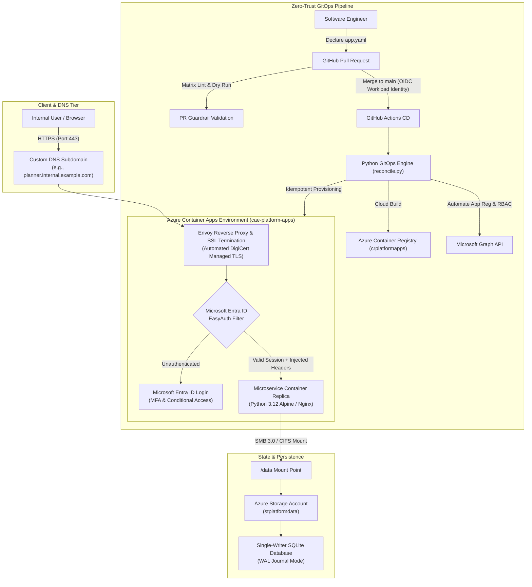

# Azure Container Apps (ACA) Enterprise Platform & GitOps Engine

[](https://azure.microsoft.com/en-us/products/container-apps/)
[](.github/workflows/)
[](terraform/)
[](docs/SECURITY_AND_IDENTITY.md)
[](LICENSE)

> **Production-grade Internal Developer Platform (IDP) and GitOps reconciliation engine for running secure, scalable microservices and internal web apps on Azure Container Apps with automated Microsoft Entra ID SSO, persistent Azure Files storage, custom domains, and managed TLS.**

---

## 🌟 Executive Overview

In enterprise organizations, deploying internal tools, operational dashboards, and microservices often creates significant friction: developers wait weeks for infrastructure tickets, authentication is implemented inconsistently, and idle Kubernetes (AKS) nodes or App Service plans inflate monthly cloud bills.

This repository provides a **Zero-Privilege, Self-Service Internal Developer Platform** designed for **Azure Container Apps (ACA)**:

- 🚀 **15-Minute Turnaround:** Developers scaffold a micro-app, define a simple declarative `app.yaml`, and merge a PR. The platform handles all cloud provisioning automatically.
- 🔐 **Zero-Trust Edge Security:** Native integration with **Microsoft Entra ID (Azure AD) EasyAuth** at the Envoy ingress layer. Unauthenticated users are stopped at the edge; authorized user claims (`X-MS-CLIENT-PRINCIPAL-NAME`) are automatically injected into container headers.
- 💾 **Zero-Cost Relational Persistence:** Solves stateful storage without expensive managed databases using **persistent Azure File Shares (SMB 3.0)** and **single-writer SQLite with WAL mode**.
- 🌐 **Automated Ingress & TLS:** Provisions DNS CNAME records and automatically binds free, auto-renewing **DigiCert Managed TLS certificates**.
- 📉 **70%+ FinOps Savings:** Workloads leverage Azure Container Apps **Scale-to-Zero**, consuming $0.00 in compute during non-working hours.
- 🛡️ **Zero-Secret CI/CD:** Fully automated via GitHub Actions using **OpenID Connect (OIDC) Workload Identity**, eliminating long-lived credentials.

---

## 🏗️ Architecture Topology



---

## ⚡ Key Platform Metrics & Business Impact

| Metric | Traditional Enterprise Baseline | Our Platform | Improvement |
| :--- | :--- | :--- | :--- |
| **Time to First Deployment** | 1–2 Weeks (Manual DevOps Tickets) | **< 15 Minutes** (Self-Service GitOps) | **90%+ Reduction** |
| **Developer Cloud Access** | Elevated Azure Portal Access | **Zero Cloud Credentials** (Pure GitOps) | **True Least Privilege** |
| **Idle Infrastructure Cost** | $150–$300/mo (Always-on AKS/VM nodes) | **$0.00 Idle** (Scale-to-Zero on ACA) | **70%+ Cloud Spend Savings** |
| **Database Cost per Internal App** | $50–$150/mo (Dedicated Postgres/MySQL) | **Pennies/mo** (Azure Files + SQLite) | **Near-Zero Database Overhead** |
| **SSO & Security Implementation** | Days of custom MSAL/OAuth boilerplate | **100% Automated** via Envoy EasyAuth | **Zero Boilerplate** |

---

## 📁 Repository Structure

```
azure-container-apps-platform/
├── .github/
│   └── workflows/
│       ├── pr-validate.yml              # Offline manifest linting & dry-run validation
│       └── gitops-deploy.yml            # Production deployment via Azure OIDC Workload Identity
├── apps/
│   └── internal-portal/                 # Central service discovery catalog & portal
│       ├── app.yaml                     # Manifest declaration
│       ├── Dockerfile                   # Nginx Alpine container
│       ├── nginx.conf                   # Static SPA & health probe routing
│       └── src/                         # Modern portal UI with real-time search & filters
├── templates/
│   └── micro-app-starter/               # Golden Path boilerplate for new apps (15-min SLA)
│       ├── app.yaml                     # Declarative cloud specification
│       ├── Dockerfile                   # Zero-dependency Python 3.12 Alpine container
│       ├── VERSION                      # Semantic version tracking
│       ├── server.py                    # Stdlib REST API, SQLite WAL persistence, health probe
│       └── src/                         # Modern glassmorphic responsive UI & identity pill
├── deploy/
│   ├── engine/
│   │   ├── reconcile.py                 # Core idempotent GitOps reconciler (Azure + Graph API)
│   │   └── validate.py                  # Offline schema & contract validator
│   ├── scripts/
│   │   ├── bootstrap-infra.sh           # One-click Azure foundation bootstrap
│   │   └── setup-workload-identity.sh   # Configures GitHub Actions OIDC federation
│   └── config/
│       └── platform.env.example         # Platform environment configuration template
├── terraform/                           # Infrastructure as Code for underlying Azure platform
│   ├── main.tf                          # RG, Log Analytics, ACA Environment, ACR, Storage, Key Vault
│   ├── variables.tf                     # Configurable inputs
│   ├── outputs.tf                       # Exposed endpoints & connection details
│   └── terraform.tfvars.example         # Sample environment values
├── docs/
│   ├── ARCHITECTURE.md                  # Deep technical dive: ACA vs AKS, Envoy, KEDA, WAL persistence
│   ├── GITOPS_SPECIFICATION.md          # Complete schema definition for app.yaml
│   ├── SECURITY_AND_IDENTITY.md         # Zero-Trust, EasyAuth, Microsoft Graph API, OIDC CI/CD
│   └── INTERVIEW_GUIDE.md               # STAR stories, architectural defenses & interview talking points
├── .gitignore
├── LICENSE                              # MIT License
└── README.md
```

---

## 📝 The 15-Minute Micro-App Golden Path

Engineers create and deploy production microservices with **zero manual Azure administrator privileges**:

### 1. Scaffold from the Golden Starter
```bash
cp -r templates/micro-app-starter apps/my-new-tool
```

### 2. Configure Declarative Manifest (`apps/my-new-tool/app.yaml`)
```yaml
version: "1.0"
app:
  name: "my-new-tool"
  title: "Team Task Tracker"
  category: "Engineering"
  icon: "📋"

routing:
  subdomain: "tasks"     # Deploys to https://tasks.internal.example.com
  targetPort: 8080

storage:
  enabled: true          # Automatically mounts Azure File Share to /data
  mountPath: "/data"
  quotaGb: 5

auth:
  provider: "entra-id"   # Enforces Microsoft Entra ID EasyAuth
  allowedGroups:
    - "Engineering"
    - "PlatformOperations"

resources:
  cpu: 0.25
  memory: "0.5Gi"
  minReplicas: 0         # Scale-to-zero when idle
  maxReplicas: 2
```

### 3. Validate Offline
```bash
python deploy/engine/validate.py --app apps/my-new-tool
```

### 4. Submit Pull Request & Merge
- **PR Check:** GitHub Actions verifies schema conformity and performs an offline dry-run feasibility check.
- **On Merge:** The GitOps workflow assumes the Azure Workload Identity, builds the container in ACR, mounts the Azure File share, updates the Container App, configures DNS/TLS, configures Entra ID group RBAC, and publishes the tool to the internal directory portal.

---

## 🚀 Quickstart & Local Setup

### Prerequisites
- [Azure CLI](https://learn.microsoft.com/en-us/cli/azure/install-azure-cli) (`az`)
- Python 3.10+
- [Terraform](https://www.terraform.io/) 1.5+ (optional, for foundation provisioning)

### 1. Bootstrap Azure Platform Foundation
You can provision the platform foundation using either the provided shell script or Terraform:

```bash
# Option A: One-click CLI script
chmod +x deploy/scripts/bootstrap-infra.sh
./deploy/scripts/bootstrap-infra.sh

# Option B: Terraform
cd terraform
cp terraform.tfvars.example terraform.tfvars
terraform init
terraform apply
```

### 2. Configure Workload Identity for GitHub Actions
Eliminate long-lived credentials by federating GitHub Actions with Microsoft Entra ID:
```bash
chmod +x deploy/scripts/setup-workload-identity.sh
./deploy/scripts/setup-workload-identity.sh "github-actions-aca-deployer" "ssaurabh61/azure-container-apps-platform"
```

### 3. Test Reconciler Dry-Run
```bash
# Validate manifest schema
python deploy/engine/validate.py --all

# Test cloud execution plan without mutating resources
python deploy/engine/reconcile.py --app templates/micro-app-starter --dry-run
```

---

## 📚 Deep-Dive Documentation Index

- [🏛️ System Architecture Deep-Dive](docs/ARCHITECTURE.md): Trade-off analysis (ACA vs AKS vs App Service), Envoy ingress, KEDA auto-scaling, and SQLite WAL concurrency on CIFS.
- [📋 GitOps Specification Reference](docs/GITOPS_SPECIFICATION.md): Full schema breakdown for `app.yaml`, resource constraints, and reconciler state machine.
- [🔐 Security & Identity Guide](docs/SECURITY_AND_IDENTITY.md): Microsoft Entra ID EasyAuth internals, token propagation, Graph API automation, and OIDC federation.
- [💼 Technical Interview Guide](docs/INTERVIEW_GUIDE.md): STAR-format talking points, metrics, and answers to tough architectural interview questions for Senior/Lead DevOps roles.

---

## 👤 Author & Maintainer

**Saurabh Shrihar**  
- **GitHub:** [@ssaurabh61](https://github.com/ssaurabh61)  
- **Role:** Senior DevOps / Platform / Cloud Infrastructure Engineer  

---

## 📄 License

This project is licensed under the MIT License - see the [LICENSE](LICENSE) file for details.
