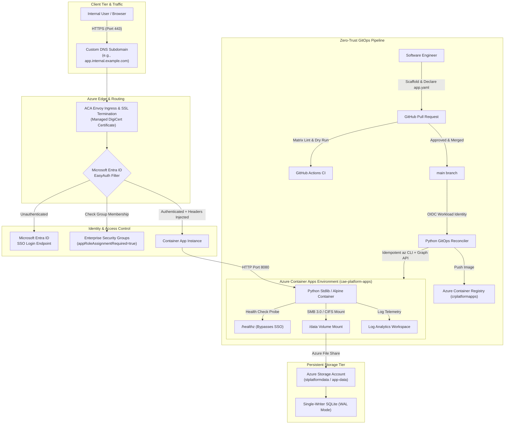

# Azure Container Apps (ACA) Enterprise Platform Architecture

This document details the architectural principles, trade-offs, and technical design decisions behind our **Azure Container Apps Enterprise Platform & GitOps Reconciliation Engine**.

---

## 1. Executive Summary & Problem Statement

### The Legacy Problem
In traditional enterprise environments, deploying internal business tools and microservices suffers from severe friction:
1. **Infrastructure Sprawl & Ticket Fatigue:** Developers file Jira tickets requesting infrastructure provisioning. DevOps engineers spend days manually configuring Azure VMs, AKS manifests, DNS records, TLS certificates, and Azure AD App Registrations.
2. **Excessive Idle Costs:** Standard Kubernetes (AKS) clusters or Azure App Service Dedicated plans incur continuous 24/7 compute charges, even though internal operational tools sit idle 70% of the time (nights, weekends, holidays).
3. **Security Inconsistencies:** Microservices implement custom, fragmented authentication libraries (often unpatched), or worse, rely on basic auth or unauthenticated networks.
4. **Elevated Privilege Risk:** Granting developers Azure Contributor or Subscription-level permissions to configure services introduces significant security and compliance risks.

### The Platform Solution
This platform establishes a **Zero-Privilege Internal Developer Platform (IDP)** on **Azure Container Apps (ACA)**:
- **Declarative Specification (`app.yaml`):** Developers declare application intent in a single file without writing cloud-specific templates.
- **Automated GitOps Reconciliation:** PR validation catches schema defects offline. On merge, an automated pipeline assumes a restricted Azure Workload Identity to provision and configure all compute, storage, DNS, TLS, and identity resources.
- **15-Minute Turnaround:** Developers go from template scaffold to production HTTPS URL in under 15 minutes.
- **Massive Cost Optimization:** Workloads leverage ACA Consumption profiles with **scale-to-zero**, reducing idle computing costs by over 70%.

---

## 2. Platform Architecture Diagram



---

## 3. Technology Trade-Off Analysis: Why Azure Container Apps?

When evaluating container runtimes for enterprise internal tools, three primary Azure compute platforms were analyzed:

| Capability | Azure Container Apps (ACA) | Azure Kubernetes Service (AKS) | Azure App Service (Linux) |
| :--- | :--- | :--- | :--- |
| **Control Plane Overhead** | **Zero** (Serverless Managed Kubernetes) | High (Requires dedicated cluster management, worker nodes, OS upgrades) | Minimal (Fully managed App Service Environment) |
| **Scale-to-Zero** | **Native** (KEDA-driven HTTP & event scaling) | Complex (KEDA on AKS requires custom node pools & virtual nodes) | Not supported on standard dedicated plans |
| **Cost for Idle Internal Tools** | **Ultra-Low** (Pay only for active execution seconds) | High (Baseline cost for system node pools ~$150-$300/mo minimum) | High ($75-$200/mo per dedicated App Service Plan) |
| **Ingress & TLS Automation** | **Built-in Envoy** with free Azure-managed DigiCert certificates | Requires manual Ingress Controller (Nginx/Traefik) + cert-manager + Let's Encrypt | Supported via App Service Managed Certificates |
| **Integrated Enterprise SSO** | **Native EasyAuth** (interception at Envoy proxy before hitting container) | Requires external OAuth2 Proxy sidecars, Pomerium, or custom code | Native EasyAuth supported |
| **Persistent Volume Mounts** | **Native Azure Files** (SMB/CIFS) mounted into container filesystem | CSI Driver for Azure Disk / Azure Files (requires PVCs/StorageClasses) | Supported via Azure Storage integration |
| **Developer Complexity** | **Low** (Simple YAML manifest or container specification) | Extremely High (Deployments, Services, Ingresses, ClusterIssuers, HPA) | Moderate |

### Conclusion
**Azure Container Apps** was chosen as the optimal sweet spot. It provides Kubernetes-level power (Envoy, KEDA, Dapr, microservice isolation) without the Kubernetes operational tax, coupled with native scale-to-zero economics.

---

## 4. Key Architectural Subsystems

### 4.1 Ingress & TLS Architecture
- **Envoy Reverse Proxy:** Every Container Apps Environment runs managed Envoy proxies routing external traffic to container replicas.
- **Custom Domain Validation:** Domain ownership is verified via DNS CNAME (`<subdomain> -> <aca-fqdn>`) and verification TXT record (`asuid.<subdomain> -> <verification-id>`).
- **Automated Managed Certificates:** DigiCert TLS certificates are automatically requested, bound, and renewed by Azure without manual intervention or third-party cert-manager overhead.

### 4.2 Persistent Storage & Single-Writer SQLite Architecture
Internal micro-apps frequently require lightweight relational persistence without the administrative burden and recurring cost of dedicated Azure Database for PostgreSQL/MySQL servers ($50–$200/mo per instance).

Our platform implements a **Single-Writer Persistent SQLite Architecture**:
1. **Azure Files Volume Mount:** An Azure File share (SMB 3.0 protocol) is provisioned and mounted directly to `/data` in the container.
2. **Write-Ahead Logging (WAL):** The application runtime executes `PRAGMA journal_mode = WAL;` and `PRAGMA busy_timeout = 5000;`. WAL separates reads from writes, allowing concurrent read queries without blocking writes.
3. **Single-Replica Constraint:** Stateful micro-apps specify `minReplicas: 1` and `maxReplicas: 1` in `app.yaml`, ensuring exactly one active writer process accessing the SQLite file over CIFS, eliminating distributed locking hazards.
4. **Zero-Database Cost:** 100+ internal microservices can run stateful relational databases for pennies of standard Azure Storage costs.

### 4.3 Zero-Trust Identity (Microsoft Entra ID EasyAuth)
Rather than requiring every micro-app team to import OAuth2/OIDC libraries, handle token refresh, and maintain vulnerable authentication dependencies:
1. **Gateway Interception:** EasyAuth intercepts every inbound HTTP request at the Envoy layer.
2. **Directory Enforcement:** The reconciler creates an Entra ID App Registration and Enterprise Service Principal with `appRoleAssignmentRequired = true`. Only users explicitly belonging to authorized Entra ID Security Groups (e.g., `Engineering`, `PlatformOperations`) are allowed past the gateway.
3. **Identity Header Propagation:** Once authenticated, Envoy injects trusted identity headers into the upstream container request:
   - `X-MS-CLIENT-PRINCIPAL-NAME`: User's corporate email / UPN (e.g., `saurabh@example.com`).
   - `X-MS-CLIENT-PRINCIPAL-ID`: Unique Entra ID Object ID.
   - `X-MS-CLIENT-PRINCIPAL-IDP`: Identity provider (`aad`).
4. **Health Probe Bypass:** Probes (`/healthz`) are configured in `--excluded-paths`, allowing ACA liveness probes and uptime monitors to query the container without redirection to Microsoft login.

---

## 5. Reliability, Observability & Day-2 Operations

### Observability Sink
- All stdout/stderr container logs, system events, and Envoy ingress logs stream automatically to a centralized **Azure Log Analytics Workspace**.
- Operational telemetry and HTTP request latencies can be queried via Kusto Query Language (KQL):
  ```kusto
  ContainerAppConsoleLogs_CL
  | where ContainerAppName_s == "micro-app-starter"
  | order by TimeGenerated desc
  | project TimeGenerated, Log_s
  ```

### Container Revision Lifecycle
- Azure Container Apps operates on **Revisions** (immutable snapshots of container configurations).
- When a new image is built or environment variables change, the reconciler spins up a new revision.
- By default, single-revision mode performs a rolling zero-downtime cutover once the new revision passes its readiness probe.
