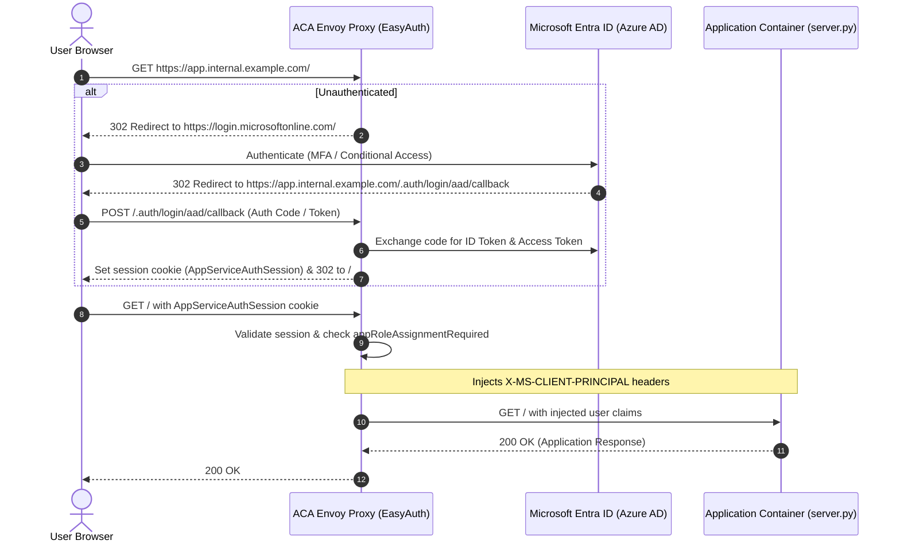

# Security, Identity & Zero-Trust Architecture

This document describes the security and identity model implemented by the Azure Container Apps Platform.

---

## 1. Zero-Trust Security Model

Our platform adheres to the core tenets of **Zero-Trust**:
1. **Verify Explicitly:** Every request is authenticated against corporate Microsoft Entra ID credentials and verified for security group membership at the edge before reaching application code.
2. **Use Least Privilege:** Application developers require zero cloud portal permissions. CI/CD automation operates via short-lived OIDC federated tokens scoped to the resource group.
3. **Assume Breach:** Container runtimes run as unprivileged, non-root users (`USER appuser`) with read-only root filesystems where applicable, and persistent storage is isolated on dedicated Azure File shares.

---

## 2. Microsoft Entra ID (Azure AD) EasyAuth Deep Dive

### 2.1 Why EasyAuth at the Edge?
Traditional microservice architectures force developers to implement authentication libraries (e.g., MSAL, Passport, NextAuth) within every application:
- **Flaws:** Inconsistent session handling, unpatched CVEs, token handling vulnerabilities, and high boilerplate overhead.
- **The Solution:** Azure Container Apps integrates **EasyAuth** directly into its managed Envoy proxy layer. Authentication occurs **before** traffic reaches the application container.



### 2.2 Automated App Registration via Microsoft Graph API
During reconciliation, the GitOps engine invokes Microsoft Graph API to automate identity provisioning:
1. **App Registration Creation:** Registers `<app-name>-auth` with `https://<custom-domain>/.auth/login/aad/callback` as an authorized redirect URI.
2. **Client Secret Generation:** Generates a secure client secret and securely injects it into Azure Container Apps secret storage.
3. **Enterprise Service Principal:** Instantiates the enterprise application object and enforces access control:
   ```python
   # Enforce that only assigned users/groups can sign in
   graph_request("PATCH", f"/servicePrincipals/{sp_id}", token, {
       "appRoleAssignmentRequired": True
   })
   ```
4. **Group RBAC Assignment:** Iterates through `allowedGroups` declared in `app.yaml`, resolves their Entra ID Object IDs, and binds them to the Service Principal (`00000000-0000-0000-0000-000000000000` Default Access role).
5. **Admin Consent:** Automatically grants standard OIDC permissions (`openid`, `profile`, `email`, `User.Read`).

### 2.3 Identity Claims Injected into Containers
Applications read authenticated user data directly from incoming HTTP headers:
- `X-MS-CLIENT-PRINCIPAL-NAME`: User's corporate email / UPN (e.g. `saurabh@example.com`).
- `X-MS-CLIENT-PRINCIPAL-ID`: Unique Entra ID user Object ID (e.g. `c74828da-...`).
- `X-MS-CLIENT-PRINCIPAL-IDP`: `aad` (Azure Active Directory).
- `X-MS-TOKEN-AAD-ACCESS-TOKEN`: Raw JWT bearer token for downstream API calls (if enabled).

---

## 3. Zero-Secret CI/CD: Azure OIDC Workload Identity

Storing long-lived Azure Service Principal secrets in GitHub repository settings creates serious compliance and rotation challenges.

Our platform utilizes **Azure Workload Identity Federation (OIDC)**:
1. GitHub Actions issues a short-lived OIDC JSON Web Token (JWT) signed by GitHub (`https://token.actions.githubusercontent.com`).
2. The Azure login action (`azure/login@v2`) exchanges this token with Microsoft Entra ID for a temporary, 1-hour Azure access token.
3. Entra ID validates the federated subject claim:
   ```json
   {
     "issuer": "https://token.actions.githubusercontent.com",
     "subject": "repo:ssaurabh61/azure-container-apps-platform:ref:refs/heads/main",
     "audience": "api://AzureADTokenExchange"
   }
   ```
4. **Result:** Zero long-lived credentials stored anywhere in GitHub repository secrets.

---

## 4. Container Hardening & Least Privilege Execution

All platform microservices adhere to strict container security practices:
- **Non-Root Execution:** Containers run under dedicated unprivileged system users (`appuser:appgroup`).
- **Minimal Base Images:** Built on Alpine Linux (`python:3.12-alpine`, `nginx:1.27-alpine`), minimizing attack surfaces and reducing image vulnerabilities.
- **Health Probe Isolation:** Liveness endpoints (`/healthz`) are isolated from authenticated business logic, allowing cluster monitoring without granting bypass access to protected routes.
- **Storage Isolation:** Volume mounts are restricted to `/data` with POSIX file permissions scoped to the runtime user.
